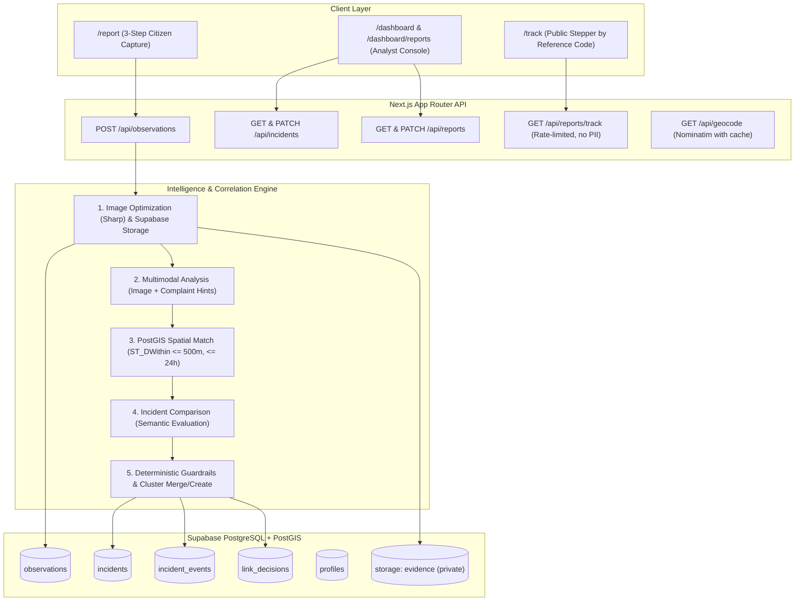

# Civitas Lens (Farzi) — Architecture & Project Structure Guide
> **Audience**: AI Coding Agents, Automated Planners & Core Engineers.  
> **Last Updated**: October 2026.  
> **Framework**: Next.js 16 (App Router, Turbopack, React 19) + Supabase (PostGIS) + Local Multimodal LLM (Gemma 4).

---

## 1. Project Overview & System Purpose

**Civitas Lens** is an autonomous municipal incident intelligence and reporting platform. Citizens report civic issues (potholes, water leaks, traffic accidents, hazards) using photos, GPS, and structured complaints. 

Instead of routing duplicate tickets to municipal departments, an intelligent correlation engine evaluates incoming reports using a **local multimodal LLM (Gemma 4)**, spatial distance calculations (**PostGIS**), and time-decay rules to automatically **cluster related reports into live incidents**, generate real-time synthesized summaries, and maintain an immutable timeline and explainability audit trail.

---

## 2. System Architecture & Information Flow



---

## 3. Directory Tree & File Manifest

```
mvp/
├── app/                                # Next.js 16 App Router
│   ├── api/                            # Server Route Handlers
│   │   ├── geocode/route.ts            # Reverse geocoding proxy with memory cache
│   │   ├── incidents/
│   │   │   ├── route.ts                # List & filter incidents (search, category, status)
│   │   │   └── [id]/
│   │   │       ├── route.ts            # Incident detail (signed image URLs, observations, events)
│   │   │       ├── detach/route.ts     # False-merge correction: splits an observation into a new incident
│   │   │       └── status/route.ts     # Incident status transitions + timeline event logging
│   │   ├── observations/
│   │   │   ├── route.ts                # Multipart form ingestion: photo upload, validation, async trigger
│   │   │   └── [id]/route.ts           # Single observation fetch by UUID
│   │   └── reports/
│   │       ├── route.ts                # Staff reports table queries, text search, urgency/status filters
│   │       ├── [id]/route.ts           # Staff inspection detail & operator actions (link, detach, reprocess)
│   │       └── track/route.ts          # Public tracking query (?code=CL-YYYY-XXXXXX); rate-limited, no PII
│   ├── dashboard/
│   │   ├── page.tsx                    # Analyst Workspace: Incident cluster map + filterable sidebar
│   │   ├── incidents/[id]/page.tsx     # Incident intelligence console: evidence cards, Why-Linked expanders
│   │   └── reports/
│   │       ├── page.tsx                # Staff Citizen Reports table + "Needs Attention" tab + re-run AI action
│   │       └── [id]/page.tsx           # Full report audit: verbatim complaint, user vs AI fields, contact card
│   ├── login/page.tsx                  # Supabase Auth login page (email + password)
│   ├── report/
│   │   ├── page.tsx                    # 3-step citizen form: 1. Photo/GPS -> 2. Details -> 3. Review/Submit
│   │   └── submitted/[id]/page.tsx     # Confirmation screen: Reference Code copy + direct /track button
│   ├── track/page.tsx                  # Public tracking portal: 4-stage stepper, category, location, status
│   ├── globals.css                     # Tailwind CSS v4 styling & theme tokens
│   ├── layout.tsx                      # Root layout, fonts, header, notification toaster
│   └── page.tsx                        # Public landing page: Call-to-actions, stats, feature highlights
│
├── components/                         # Modular React components
│   ├── evidence-badge.tsx              # Badges for capture source (live camera/upload) and GPS accuracy
│   ├── layout/
│   │   └── header.tsx                  # Global navigation bar: role badge, auth state, mobile drawer
│   ├── map/
│   │   ├── incident-cluster-map.tsx    # Leaflet cluster map with severity-colored markers
│   │   ├── incident-detail-map.tsx     # Multi-marker incident map showing observation centroids
│   │   ├── map-picker.tsx              # Interactive map coordinate picker for manual pin fallback
│   │   ├── map-thumbnail.tsx           # Static/compact Leaflet map preview
│   │   └── index.ts                    # Dynamic Leaflet component exports (SSR: false)
│   └── ui/                             # Standard reusable UI primitives (Button, Input, Badge, Skeleton, Alert)
│
├── docs/                               # Architecture and system documentation
│   ├── PROJECT_CONTEXT.md              # Core constraints, design rules, and data model contracts
│   └── WALKTHROUGH.md                  # Comprehensive end-to-end system walkthrough & testing steps
│
├── samples/                            # Sample visual evidence for testing and demo seeding
│   └── water-main-break.jpg            # Sample roadway flooding evidence photo
│
├── scripts/                            # Operational & automated test scripts
│   ├── seed-demo.ts                    # Seeds realistic Nagpur demo (4 correlated reports + 4 decoys)
│   ├── test-complaint-flow.ts          # End-to-end verification of complaint validation, AI prompts, /track
│   ├── test-checklist.ts               # Core test checklist runner
│   ├── test-pipeline.ts                # Direct test of sharp + Gemma + PostGIS pipeline
│   └── test-llm.ts                     # Direct connectivity & schema validation test for LLM client
│
├── src/                                # Core Business Logic & AI Engines
│   ├── config/
│   │   └── matching.ts                 # Correlation thresholds (500m, 24h, 0.45 confidence, category matrix)
│   └── lib/
│       ├── llm/                        # Multimodal LLM Client & Prompts
│       │   ├── client.ts               # OpenAI-compatible fetch client (supports image base64, 60s timeout)
│       │   ├── image.ts                # Server-side Sharp image resize (max 896px) & JPEG conversion
│       │   ├── json.ts                 # Generic callJson helper with schema retry on invalid JSON
│       │   ├── schemas.ts              # Zod schemas: ObservationAnalysis, RelationshipDecision, Summary
│       │   └── prompts/
│       │       ├── analyze-observation.ts  # Gemma vision prompt: Image first, then citizen complaint hints
│       │       ├── compare-observation.ts  # Gemma comparison prompt: Candidate matching using complaint text
│       │       └── summarize-incident.ts   # Multi-observation summary synthesis prompt
│       ├── pipeline/
│       │   ├── coordinates.ts          # PostGIS Geography POINT parser/extractor
│       │   ├── process.ts              # Core pipeline: Gemma analysis -> candidate search -> merge/create
│       │   └── index.ts                # Pipeline exports
│       └── supabase/
│           ├── admin.ts                # Service role Supabase client for pipeline & background writes
│           ├── client.ts               # Browser Supabase client
│           └── server.ts               # SSR / Server Component Supabase client
│
├── supabase/migrations/                # Version-controlled Database Migrations
│   ├── 00000_combined.sql              # All migrations consolidated into one executable file
│   ├── 00001_enable_extensions.sql     # postgis, uuid-ossp, pgcrypto
│   ├── 00002_create_enums.sql          # Categories, severities, incident/observation statuses
│   ├── 00003_create_tables.sql         # profiles, incidents, observations, incident_events, link_decisions
│   ├── 00004_create_indexes.sql        # GIST spatial indexes, btree indexes for time and foreign keys
│   ├── 00005_create_storage_bucket.sql # Creates private "evidence" storage bucket
│   ├── 00006_create_functions.sql      # find_candidate_incidents RPC spatial search function
│   ├── 00007_create_views.sql          # active_incidents_view helper
│   ├── 00008_rls_policies.sql          # Row Level Security policies
│   ├── 00009_seed_placeholder.sql      # Seed placeholder
│   ├── 00010_add_capture_metadata.sql  # location_accuracy_m, capture_source, location_source, captured_at
│   ├── 00011_auth_profiles_trigger.sql # Automatically provisions citizen profiles on auth.users insert
│   └── 00012_add_complaint_and_reference_code.sql # user_category, user_urgency, reporter_*, reference_code
│
├── middleware.ts                       # Route protection: guards /dashboard to analyst/admin roles
├── next.config.ts                      # Next.js configuration (turbopack, cacheComponents, experimental)
└── package.json                        # Dependencies, scripts, and runtime configuration
```

---

## 4. Database Schema & Data Models

### 4.1 Tables Summary

| Table | Primary Key | Key Columns & Types | Description |
|---|---|---|---|
| `profiles` | `id` (uuid refs `auth.users`) | `role` (`citizen` \| `analyst` \| `admin`), `created_at` | User account profiles with RBAC. |
| `incidents` | `id` (uuid) | `title`, `category`, `severity`, `status`, `summary`, `centroid geography(Point,4326)`, `observation_count`, `first_seen_at`, `last_seen_at` | Synthesized real-world incident clusters. |
| `observations` | `id` (uuid) | `incident_id` (fk), `reporter_id` (fk), `raw_text`, `reference_code` (unique), `user_category`, `user_urgency`, `reporter_name`, `reporter_contact`, `image_path`, `location geography(Point,4326)`, `location_label`, `location_accuracy_m`, `capture_source`, `location_source`, `category`, `severity`, `summary`, `processing_status`, `ai_raw` (jsonb) | Individual citizen field reports. |
| `incident_events` | `id` (uuid) | `incident_id` (fk), `observation_id` (fk), `type` (`created` \| `observation_added` \| `status_changed` \| `summary_updated` \| `severity_changed`), `note`, `created_at` | Append-only audit timeline for each incident. |
| `link_decisions` | `id` (uuid) | `observation_id` (fk), `candidate_incident_id` (fk), `gemma_related` (bool), `gemma_reason` (text), `confidence` (float), `passed_validation` (bool), `distance_m`, `time_diff_min` | Full explainability audit log of every merge decision. |

### 4.2 Key Enums
- **Category (`observation_category`)**: `infrastructure`, `safety_concern`, `accident`, `environmental`, `unusual_activity`, `other`
- **Severity (`incident_severity`)**: `low`, `medium`, `high`, `critical`
- **Incident Status (`incident_status`)**: `new`, `under_review`, `active`, `resolved`, `archived`
- **Processing Status (`processing_status`)**: `pending`, `processed`, `needs_review`, `failed`
- **User Urgency (`user_urgency`)**: `'low'`, `'medium'`, `'high'`

---

## 5. Core AI Correlation Pipeline

The pipeline is implemented in [src/lib/pipeline/process.ts](file:///d:/Hackathons/Temp/mvp/src/lib/pipeline/process.ts) via `processObservation(observationId)`:

```
[Citizen Submission]
        │
        ▼
[Step 1: Gemma 4 Multimodal Analysis]
   - Input: Resized Image (896px max) + Citizen complaint text + User category hint + Urgency hint
   - Rule: Image placed FIRST in message payload, followed by text
   - Output: AI category, severity, summary, key entities, confidence score
        │
        ▼
[Step 2: Candidate Search via PostGIS RPC]
   - Executes find_candidate_incidents(lat, lng, radius_meters=500, window_hours=24)
   - Filters candidate incidents within 500m radius and observed within the last 24h
        │
        ├────────────────────────────────────┬────────────────────────────────────┐
        ▼ (No candidates found)              │                                    ▼ (Candidates found)
[Step 3A: Create New Incident]               │                       [Step 3B: Gemma 4 Semantic Comparison]
   - Creates new incidents row               │                          - Compares new observation (complaint + AI)
   - Initial centroid = observation location │                            against up to 5 candidate incidents
   - Urgency rule: If user urgency is High,  │                          - Returns matched_incident_id, related, reason
     incident severity is >= 'medium'        │                                    │
     and status is set to 'under_review'     │                                    ▼
   - Appends 'created' incident_events row   │                       [Step 3C: Hard Deterministic Validation]
                                             │                          - Condition 1: Gemma says related (confidence >= 0.45)
                                             │                          - Condition 2: Distance <= 500 meters
                                             │                          - Condition 3: Time gap <= 24 hours
                                             │                          - Condition 4: Category compatibility matrix passes
                                             │                                    │
                                             │                    ┌───────────────┴───────────────┐
                                             │                    ▼ (Validation passes)           ▼ (Validation fails)
                                             │           [Step 3D: Merge into Incident]  [Create New Incident]
                                             │             - Sets observation.incident_id   (Distinct real-world event)
                                             │             - Recalculates centroid
                                             │             - Elevated severity = max(...)
                                             │             - High urgency: severity >= med,
                                             │               status = 'under_review'
                                             │             - Logs 'observation_added'
                                             │             - Regenerates AI incident summary
                                             │
                                             ▼
                                  [Step 4: Audit Logging]
                                     - Records decision to link_decisions
                                     - Updates processing_status to 'processed'
```

### Correlation Thresholds ([src/config/matching.ts](file:///d:/Hackathons/Temp/mvp/src/config/matching.ts))
- `radiusMeters`: `500` (Max radius for merging)
- `windowHours`: `24` (Temporal correlation window)
- `minGemmaConfidence`: `0.45` (Secondary signal threshold)
- `CATEGORY_COMPATIBILITY_MAP`: Defines permissible cross-category merges (e.g. `infrastructure` $\leftrightarrow$ `environmental` for water pipe breaks causing flooding).

---

## 6. API Endpoints Reference

### Public Citizen Endpoints
- **`POST /api/observations`**
  - **Payload**: `FormData` (`lat`, `lng`, `text` [10–1000 chars], `user_category`, `user_urgency`, optional `photo`, optional `reporter_name`, optional `reporter_contact`).
  - **Returns**: HTTP 201 with `{ id, reference_code, user_category, user_urgency }`.
  - **Behavior**: Saves image to storage, inserts observation as `pending`, and triggers `processObservation` in the background.
- **`GET /api/reports/track?code=CL-YYYY-XXXXXX`**
  - **Query**: Citizen human-friendly reference code or UUID.
  - **Rate Limiting**: 30 requests/minute/IP.
  - **Privacy**: **Strictly omits** `reporter_name` and `reporter_contact`.
  - **Returns**: Public 4-stage stepper state (`received` $\rightarrow$ `under_review` $\rightarrow$ `action_in_progress` $\rightarrow$ `resolved`), category, summary, timestamp, location label.
- **`GET /api/geocode?lat=...&lng=...`**
  - Reverse geocoding with in-memory LRU cache.

### Staff / Analyst Endpoints
- **`GET /api/reports`**
  - **Query params**: `search`, `category`, `urgency`, `status`, `linked` (`all` \| `linked` \| `unlinked`), `page`, `limit`.
  - **Returns**: Paginated list of observations with signed image URLs and incident links.
- **`GET /api/reports/[id]`**
  - Returns complete observation record, verbatim complaint text, side-by-side user vs AI fields, reporter contact details, and `link_decisions` log.
- **`PATCH /api/reports/[id]`**
  - **Actions**: `link` (attach to incident), `detach` (split into new incident), `mark_reviewed`, `mark_needs_review`, `reprocess` (re-run AI analysis).
- **`GET /api/incidents`**
  - List incidents with map centroid coordinates and filtering.
- **`GET /api/incidents/[id]`**
  - Incident intelligence console data: centroid, observations with signed image URLs, `incident_events` audit timeline, and `link_decisions`.
- **`PATCH /api/incidents/[id]/status`**
  - Updates incident status (`new`, `under_review`, `active`, `resolved`, `archived`) and records an immutable timeline entry.
- **`POST /api/incidents/[id]/detach`**
  - Human correction: moves an observation from an existing cluster into a freshly initialized incident.

---

## 7. Frontend Structure & Key UI Routes

| Route | Purpose | Key Components & Features |
|---|---|---|
| `/report` | Citizen Reporting Flow | 3-step form (`Photo/Location` $\rightarrow$ `Details` $\rightarrow$ `Review/Submit`). Category chips, character counter, urgency radio cards, draft state in `sessionStorage` (text only). Allows submission without photo. |
| `/report/submitted/[id]` | Confirmation Screen | Prominently displays Reference Code (`CL-YYYY-XXXXXX`), copy button, and link to track online. |
| `/track` | Public Status Portal | Single input for reference code. Renders 4-stage status stepper with zero PII exposure. |
| `/dashboard` | Incident Workspace | Left: Filterable incident list (search, category, severity, status). Right: Leaflet marker cluster map. Real-time updates via Supabase Realtime. |
| `/dashboard/incidents/[id]` | Incident Detail & Audit | Printable intelligence sheet. AI summary card, multi-observation mini-map, collapsible 3-line evidence cards with "Read more" toggle, "Why linked?" explainers, observation detachment button, and vertical audit timeline. |
| `/dashboard/reports` | Staff Citizen Reports | Tabbed table view ("All Reports" vs "Needs Attention"). Full-text search over complaints, urgency badges, and "Re-run AI analysis" action. |
| `/dashboard/reports/[id]` | Staff Report Inspection | Verbatim citizen complaint, side-by-side AI vs user fields, operator actions (Link, Detach, Review status), staff-only contact card. |
| `/login` | Authentication | Clean citizen/analyst login screen. Role badge displayed in header. |

---

## 8. Development & Operational Commands

```bash
# 1. Start development server
npm run dev

# 2. Production build verification (Must pass with code 0)
npm run build

# 3. Seed realistic Nagpur demonstration scenario (Water main burst + 4 decoys)
npm run seed:demo

# 4. Run end-to-end complaint verification test suite
npm run test:complaint

# 5. Run standard test checklist
npm run test:checklist

# 6. Test LLM client connectivity & schema validation
npm run test:llm

# 7. Test direct image pipeline
npm run test:pipeline
```

---

## 9. Environment Variables Reference (`.env`)

```ini
# Supabase Configuration
NEXT_PUBLIC_SUPABASE_URL=https://your-project.supabase.co
NEXT_PUBLIC_SUPABASE_ANON_KEY=your-anon-key
SUPABASE_SERVICE_ROLE_KEY=your-service-role-key

# Multimodal LLM Configuration (Ollama or OpenAI-compatible)
LLM_BASE_URL=http://localhost:11434/v1
LLM_MODEL=gemma4:e2b
LLM_API_KEY=optional-ollama-api-key

# Pipeline Tuning (Optional overrides)
CORRELATION_RADIUS_METERS=500
CORRELATION_WINDOW_HOURS=24
```

---

## 10. Important Conventions & Gotchas for AI Agents

1. **Next.js 16 `cacheComponents` Rule**:
   - `next.config.ts` has `cacheComponents` enabled. **Do NOT use** `export const dynamic = "force-dynamic";` in route handlers; it will fail production builds.
2. **Multimodal Payload Ordering**:
   - Gemma vision guidelines strictly require the **image to appear FIRST** in the message payload, followed by the text block.
3. **Citizen Data vs AI Truth**:
   - User category and urgency are treated as **hints**, not ground truth. Both `user_category` / `user_urgency` and AI-assessed `category` / `severity` are stored separately and presented side-by-side to staff.
4. **High Urgency Escalation**:
   - If a citizen marks `user_urgency === 'high'`, the pipeline **must** enforce that the resulting incident severity is at least `'medium'` and that the status is set to `'under_review'`.
5. **Privacy Safeguards**:
   - `/api/reports/track` must **never** return `reporter_name`, `reporter_contact`, or any details of other citizens' observations.
6. **False-Merge Detachment**:
   - If an observation is detached via `/api/incidents/[id]/detach`, it is automatically promoted to its own new incident cluster, leaving the original incident intact with remaining observations.
